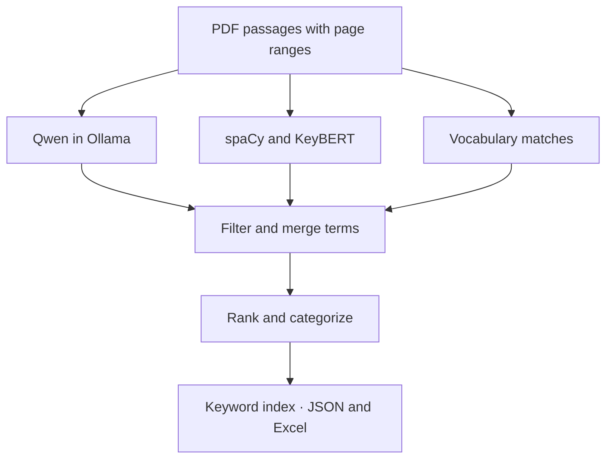

<h1 align="center">RAG-Based Keyword Extraction</h1>
<p align="center">A searchable keyword index for Indian power-sector PDFs</p>
<p align="center"><a href="#approach">Workflow</a> · <a href="#results">Sample results</a> · <a href="#tools-and-setup">Run locally</a></p>

## Problem statement

Which pages of a tariff order discuss *benchmark capital cost*? A reader may have to search a long PDF for the full term, its acronym, and variations in wording. This project builds an index that brings those terms together, groups them by topic, and points readers back to the relevant pages.

## Approach

Each passage feeds three extraction methods. Their candidates come together before ranking, so a phrase can enter the index through its context, its wording, or a match with the power-sector vocabulary.



## Methodology and techniques

| Stage | How it works |
| --- | --- |
| **Prepare passages** | Split clean text into chunks of about **1,200 words**, with a **200-word overlap** to preserve context near boundaries. Keep the page range for each chunk. |
| **Extract terms** | Qwen reads each passage alongside a reference vocabulary. spaCy finds noun phrases, KeyBERT suggests keyphrases, and exact matching picks up known sector terms. |
| **Resolve variations** | Compare term embeddings with domain examples using cosine similarity. Link acronyms to their full forms and merge similar candidates. |
| **Select the final index** | Maximal Marginal Relevance balances a term’s relevance with how much it differs from terms already selected. Each exported entry includes its category and available page references. |

[Explore the pipeline](main.py) · [View vocabulary and thresholds](config.py)

## Results

> **66 pages → 80 keywords** in the included tariff order. The table shows three entries from the saved output.

| Keyword | Category | Ranking score |
| --- | --- | ---: |
| **Tariff Order** | Regulatory | 0.9143 |
| **Benchmark Capital Cost** | Economic & Financial | 0.8429 |
| **Area Control Error** | Grid Operations | 0.8143 |

Open the spreadsheet to browse terms and page references, or use the JSON for analysis.

[Browse the Excel index](keywords_output.xlsx) · [Explore the JSON](keywords_output.json) · [Read the sample PDF](test.pdf)

## Tools and setup

The project uses Python, Ollama with `qwen2.5:3b`, spaCy, KeyBERT, and Sentence Transformers with `all-mpnet-base-v2`. Excel export uses openpyxl.

### 1. Install the dependencies

With Python 3 and Ollama installed, run the following in a macOS or Linux terminal.

```bash
git clone https://github.com/Shilpeekumari23/RAG-Based-Keyword-Extraction.git
cd RAG-Based-Keyword-Extraction
python3 -m venv .venv
source .venv/bin/activate
python -m pip install -r requirements.txt openpyxl
python -m spacy download en_core_web_sm
```

### 2. Prepare the local model

Open the Ollama desktop app or run `ollama serve` in a separate terminal. Then download the model.

```bash
ollama pull qwen2.5:3b
```

The [model client](llm_extractor.py) sends each passage and the reference vocabulary to `http://localhost:11434/api/generate`. The default local setup requires no login, API key, or bearer token.

### 3. Run the sample PDF

```bash
python main.py test.pdf --top-k 20 --output sample_run.json
```

Open `sample_run.xlsx` to browse up to 20 keywords, or use `sample_run.json` for further analysis. To process your own document, replace `test.pdf` with its path. Omit `--top-k` to use the default limit of 80.
